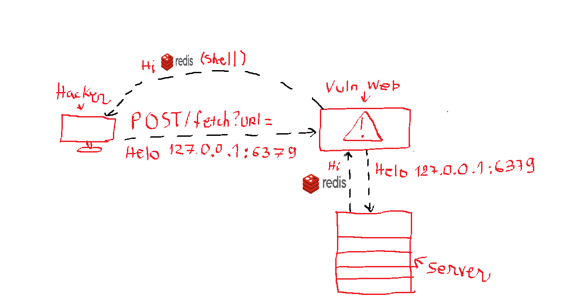

# SSReFuse


SSRF detection that fuses static analysis with LLM reasoning, evaluated against a lab that runs
rather than a corpus that is read.

The repository has three parts: a hermetic SSRF testbed, a classified catalog of bypass payloads, and
three detector tiers (sink inventory, taint analysis, LLM judge) scored over one labelled corpus
that spans three languages. The three labs implement the same guard taxonomy, so where a row of the
matrix differs between them, the runtime is the finding.



That is the whole bug class in one line. The attacker never reaches `127.0.0.1:6379`; the
server reaches it for them, and the port is open because nothing outside was ever supposed to
ask. Everything below is an attempt to measure where that line actually stops.

## Why the ground truth is dynamic

A rule that reports "SSRF here" is a hypothesis. Whether it holds is settled by sending a request.
So the labels in this project are not the end of the evidence chain. A prober fires every applicable
payload value at every route -- 132 values across 34 families -- and reads the canary string out of
the response body, or out of the target's own access log when the body is discarded. `corpus/ground-truth.yaml` states which routes are vulnerable; the
prober states which payloads reached an internal target; the evaluator prints both and flags every
disagreement. Where the two differ, either the lab or the catalog is wrong, and the report says so
instead of averaging it away.

## Testbed

Every measurement runs inside an unprivileged network namespace (`unshare -r -n -m`). Inside it:

| address | service |
|---|---|
| `127.0.0.1:19001` | internal admin service holding the canary `SSREFUSE-INTERNAL-ADMIN-SECRET` |
| `127.0.0.1:2375` | Docker Engine API, the hop that turns a read primitive into host execution |
| `127.0.0.1:9200` | Elasticsearch |
| `127.0.0.1:8500` | Consul KV |
| `127.0.0.1:8081` | Spring Boot actuator |
| `127.0.0.1:6379` | Redis: a line protocol, not HTTP, reachable only by a sink that speaks `gopher://` |
| `127.0.0.1:11211` | Memcached, same |
| `127.0.0.1:19999` | nothing, on purpose: the control that makes "connected" mean something |
| `10.0.0.10` | another host inside RFC 1918, reached by address and by name |
| `169.254.169.254` | cloud metadata: IMDSv1 answers a plain GET, while the GCP, Azure and IMDSv2 paths require a request header and refuse without it |
| `169.254.170.2` | ECS task metadata, which needs no header |
| `100.100.100.200` | Alibaba Cloud metadata |
| `192.88.99.10` | the "public" host the application allowlists, also attacker-controlled, with an open redirect |
| `100.64.0.10` | RFC 6598 shared address space, the range most guards forget |
| `192.88.99.20` | out-of-band canary logging every DNS query and HTTP hit |

The range is drawn from what SSRF is pointed at in production, not from a training exercise. It is
there because an SSRF is rarely the finding: on its own it reads "the server fetched a URL", and the
severity is the next hop. `results/report.md` prints each target next to the escalation it leads to,
and is explicit that the harness measures reaching the service and does **not** perform the hop.

An authoritative DNS server serves the `ssrefuse.test` zone, in which `rebind.ssrefuse.test` answers
with the public address and the loopback address alternately at TTL 0. DNS rebinding happens for real
there; it is not simulated.

Before any measurement, the harness checks two things and refuses to measure if either fails: TCP to
`1.1.1.1:443` must not connect, and `example.com` must not resolve. That is why exercising a metadata
endpoint in this repository never touches a cloud provider.

`192.88.99.0/24` is the public stand-in because Python classifies it `is_global=True`. The RFC 5737
documentation ranges are classified private, so a guard of the form "resolve and reject private
addresses" would reject the allowlisted host and make every guard look stronger than it is. The
192.88.99.0/24 prefix was deprecated by RFC 7526 and belongs to nobody.

## Running it

```sh
make venv        # create .venv, install semgrep and dependencies
make all         # validate corpus -> probe -> scan -> report
```

Or without make: `pip install -r requirements.txt`, or `requirements-lock.txt` for the exact
versions these numbers were measured on.

The Python lab runs on the project venv. The JavaScript lab needs `node` on PATH (built and
measured on v24.19.0) and installs nothing: it uses only the Node standard library, and the router
is written out rather than taken from a package.

The result lands in `results/report.md`. Stages run on their own:

```sh
make selftest    # build the sandbox and print the evidence that it is hermetic
make probe       # fire the whole catalog at every variant
make scan        # run the static detectors with their positive control
make report      # score what has been measured
make test        # 87 tests
```

`make probe --apps flask_ssrf` (or `node_ssrf`) measures one lab on its own.

### Running the whole thing somewhere else

`make bench` is one measurement from start to finish, for a machine that is not
the one it was built on:

```sh
make bench                      # preflight, validate, probe, scan, both judge arms, report
make bench PROVIDER=opencode    # the same, through a local agent server instead of a vendor API
```

`make preflight` runs first and on its own. It checks the sandbox tooling
(`unshare`, `ip`, `mount`, `ss`), semgrep, the corpus markers, the interpreter
that will actually start each lab -- the project venv's, not whatever `python3`
resolves to -- and each lab's declared runtime floor, plus the LLM transport if
one is named. It exits non-zero on anything that would stop a run part way,
because a results directory from a half-finished bench looks like a result.

The runtime floor is enforced rather than documented. `php_ssrf` declares
`min_runtime: 8.4.27` and the probe refuses to start it on anything lower: PHP
8.4.0 through 8.4.26 are affected by CVE-2026-109618 and CVE-2026-109619, both
unauthenticated RCE at CVSS v4.0 9.2, and this lab is fed attacker-shaped input
by design. The version is read from the interpreter that is about to serve the
requests and recorded next to the probe rows.

`ssrefuse probe --apps <lab>` is for trying one lab and writes to its own
`partial-*.json`. It leaves the aggregate the report reads untouched and says
so, because it used to overwrite it -- after which a report said the other labs
had no reproduced bypasses rather than that they had not been measured.

The LLM tier needs an API key. Put it in `.env`, which is gitignored:

```sh
cp .env.example .env && chmod 600 .env
$EDITOR .env                      # DEEPSEEK_API_KEY=...
make judge                        # both arms of the ablation, then report
```

The ablation holds the model fixed and moves the thinking budget, because
thinking is a request parameter rather than a model name:

```sh
ssrefuse judge --effort none --rounds 2     # the parameter is not sent at all
ssrefuse judge --effort high --rounds 2
ssrefuse report
```

`--effort none` is not `--effort low`: one omits the parameter, the other asks
for a small budget, and conflating them would attribute the provider's default
to this project. The cache is keyed on the effort as well as the prompt, so
neither arm can be served the other's answers.

The ablation's whole claim is that its two arms ran at different budgets, and
nothing in the verdict columns shows whether they did -- an arm labelled `off`
that thought anyway returns a complete, plausible table. So the budget is
checked against the provider's own token accounting, both ways: `off` must
have spent no reasoning tokens, and `low`/`high`/`max` must have spent some.
A failure exits non-zero and the report leaves that arm out of the comparison
and names it, because a thinking arm that did not think makes the ablation one
arm measured twice. `none` claims nothing and is checked for nothing. On a
transport that reports no usage the control comes back `not_checked`, which is
not the same as passing: the budget is unknown, not zero. What the thinking cost is
recorded per judgement from the provider's own accounting, because "the
reasoning tier scored higher" and "scored higher at nine times the tokens" are
different findings.

Model ids were checked against the provider changelog on 2026-10-20 and the
previous ones were already stale: `deepseek-chat` and `deepseek-reasoner`
selected non-thinking and thinking mode and were scheduled for retirement on
2026-07-24. Re-check before a submission. `--provider openrouter` and
`--provider openai-compatible` reach the same chat-completions shape elsewhere.

### Two kinds of backend

A model is reached here either by calling a vendor's API with a key, or by
handing the prompt to an agent tool that already holds one. Both are kept,
because they fail in opposite directions and the choice per arm is a real one.

```sh
opencode service start            # the server this transport talks to
opencode models                   # ids, as `provider/model`
ssrefuse judge --provider opencode --model opencode-go/deepseek-v4.1-flash \
                --effort high --rounds 2
```

The agent transport needs no key in `.env` and costs nothing per call beyond
the subscription the account already has, which is what makes a second
provider affordable at all: the same candidate set judged by two models is a
check on whether a result belongs to the method or to one vendor's model. On
some machines it is also the only way in, because the gateway's proxy refuses
an ordinary HTTP client from this host with `403 error code: 1010` -- a
client-signature rejection, identical for a valid and an invalid token, so
that response says nothing about credentials.

What it gives up is accounting, and the report says so rather than filling the
gap:

| | vendor API | agent transport |
|---|---|---|
| key needed here | yes | no |
| token usage | reported | **`n/a`, never `0`** |
| chain of thought | returned in its own field | not returned |
| temperature | sent | not settable |
| JSON mode | requested | unavailable; answer parsed from prose |
| thinking budget | request parameter, incl. `off` | declared model variant; **no `off`** |

The thinking budget is still a real knob on the agent transport rather than a
hopeful one: the server validates the variant and rejects an undeclared value
with HTTP 400, so `--effort high` either ran at `high` or failed loudly. The
`off` arm is the exception -- no variant disables thinking, so asking for it
raises and points at `--provider deepseek` instead of quietly running the
model's default under a label that claims otherwise.

The provider half of a model id is the billing tier, not decoration:
`opencode-go/...` draws on the subscription, the `opencode/...` mirror of the
same model is pay-per-token, and `...-free` has a daily ceiling. A spent
budget comes back as a terminal error and is raised rather than retried.

Every command loads `.env` before it runs and prints which variables it set,
by name and never by value. A variable already exported in the shell wins over
the file, so `export DEEPSEEK_API_KEY=...` still overrides it. A blank key is
reported as `empty` rather than treated as present, because a judge that
silently did not run is the one failure this project cannot afford.

Without a key, `--provider mock` exercises the whole pipeline. Every mock answer is labelled, and the
report states that those rows are not measurements.

## Corpus

72 variants, 55 vulnerable and 17 safe, across three labs that implement the same guard taxonomy:

| lab | file | variants | runtime |
|---|---|---|---|
| `flask_ssrf` | `corpus/labs/flask_ssrf/app.py` | 28 | Flask, `requests` / `httpx` / `urllib` / curl |
| `node_ssrf` | `corpus/labs/node_ssrf/app.js` | 28 | Node standard library, `fetch` / `http.get` / curl |
| `php_ssrf` | `corpus/labs/php_ssrf/app.php` | 16 (13 vulnerable, 3 safe) | PHP built-in server, `file_get_contents` / `curl_exec` |

Each variant is one route with one guard, from nothing at all (`G0`) to a correct one (`G8`: resolve
once, classify the address, connect to that same address, refuse redirects). The safe routes in
each lab are the false-positive control set, and each has to record why it is safe.

The PHP lab is not there to make the count larger. It is there because two of the guards answer
differently in PHP, and both differences were measured on 8.4.27 rather than assumed:

* **`parse_url()` does not canonicalise the authority.** `2130706433`, `0177.0.0.1`, `0x7f000001`,
  `127.1` and `127.0.0.1.` all come back verbatim, where Node's `URL()` rewrites every one of them
  to `127.0.0.1`. The host-denylist row therefore holds in one lab and falls in the other with the
  same guard code. Confirmed on the running app: `url=http://127.0.0.1/` is blocked and
  `url=http://2130706433/` passes the guard.
* **`filter_var(..., NO_PRIV_RANGE|NO_RES_RANGE)` calls three addresses public** that a reader would
  expect it to reject: `100.64.0.10` (CGNAT), `100.100.100.200` (Alibaba metadata) and `203.0.113.5`
  — the last of which Python's `ipaddress` calls private. A resolve-and-classify guard built on it
  has holes the same guard in Python does not.

`php-012` and `php-014` are the pair that makes this readable: identical resolve-and-pin mechanism,
one predicate each, and only the one built on `filter_var` is reachable. The hole is the predicate,
not the pinning, and the pair is the evidence rather than the assertion.

PHP also widens the sink surface. `file_get_contents` reaches every stream wrapper the build has —
`file`, `php`, `data`, `glob`, `phar`, `zip` — so one call is both an HTTP client and a file reader;
and `curl_version()['protocols']` lists `dict`, `gopher`, `ldap`, `telnet` and `tftp` in-process,
where the Python lab reaches that surface only by shelling out to the curl binary. A URL handed to
`curl_setopt($ch, CURLOPT_URL, $url)` is also two statements away from the call that sends the
request, which is a different thing for a taint engine to follow than a single tainted argument.

Every route calls its own sink rather than sharing a fetch helper. The shared helper is the better
code and the worse benchmark: with one helper, every static finding lands on the same two lines and
cannot be attributed to any route. Each lab keeps exactly one deliberately shared sink, marked as
shared, which is the interprocedural variant.

Variant boundaries are not stored as line numbers. They are read from `@ssrefuse:begin` markers in the
source, so editing a lab cannot silently invalidate a label. The loader cross-checks both directions
and prints every mismatch.

## Current numbers

Over all 72 variants, scored against the declared labels:

| detector | TP | FP | FN | TN | precision | recall |
|---|---|---|---|---|---|---|
| sink inventory | 55 | 11 | 0 | 6 | 0.833 | 1.000 |
| taint, no sanitizers | 48 | 8 | 7 | 9 | 0.857 | 0.873 |
| taint, naive sanitizers | 48 | 8 | 7 | 9 | 0.857 | 0.873 |

Split by language, because a single row would hide which half carries which error:

| detector | Python P / R | JavaScript P / R |
|---|---|---|
| sink inventory | 0.818 / 1.000 | 0.818 / 1.000 |
| taint, no sanitizers | 0.833 / 0.833 | 0.842 / 0.889 |
| taint, naive sanitizers | 0.833 / 0.833 | 0.842 / 0.889 |

Declaring the sanitizers a reviewer would reach for changes nothing in either language. That is the
measurement, not an oversight: `new URL(u).hostname` and `urlparse(u).hostname` sanitise the
hostname, and the value that reaches the sink is the URL.

The LLM judge, run for real against `deepseek-flash` over the same candidate set, with the
thinking budget as the only thing that moves between arms:

| tier | P | R | F1 |
|---|---|---|---|
| sink inventory | 0.818 | 1.000 | 0.900 |
| taint analysis | 0.838 | 0.861 | 0.849 |
| LLM judge, thinking off | 0.882 | 0.833 | 0.857 |
| LLM judge, thinking high | 0.943 | 0.917 | 0.930 |
| **fused cascade, judge-decided cells only** | **0.943** | **1.000** | **0.971** |

Three things in that table are worth more than the ranking.

**Thinking costs twelve times the output tokens for seven points of F1.** 28k output tokens
against 345k, of which 319k is reasoning, and eight times the wall clock. Whether that trade is
worth taking is a decision, and the report prints both halves of it rather than only the half that
flatters the model.

**The one false positive neither arm gives up is the same one: the correct guard.** `py-014` and
`js-015` resolve the hostname once, validate the address, and connect to that address. Both arms
call them vulnerable. A model that cannot be convinced a correct pin-and-connect is correct is a
specific, nameable failure, and it is the failure that matters most for a tool meant to reduce
review load.

**Thinking helped the Python interprocedural slices and not the JavaScript ones.** With thinking
off, the judge declined `py-003`, `py-004`, `js-003` and `js-004`; with it on, it decided the
Python pair and still declined the JavaScript one. That is the documented weakness of the
character-scanner slicer showing up as a measurement rather than as a caveat.

The interesting rows are the ones the table does not have: six variants on which all three static detectors
are wrong, `py-012`, `py-014`, `py-023` and their JavaScript twins. All six have guards of the right
shape; `py-014` and `js-015` are correct, the rest are correct within what was measured. Pattern
matching cannot separate a guard that has the right shape from a guard that has an effect, because
the real question is whether the value that was checked is the value that gets fetched. That
question is what the LLM judge is given.

Taint analysis misses the two interprocedural variants in each lab, and `py-020`, where one request
stores the URL and another fetches it. It catches `js-020`, the same second-order flow, for the
wrong reason: the job id is also request-controlled, so the taint reaches the sink line through the
lookup key rather than through the stored URL. Sink inventory catches all 36 and pays for it on
`py-022` and `js-022`, routes whose URL is a module constant.

## Bypass matrix

`results/report.md` carries the full variant-by-family table. Some rows:

- `py-011`, exact hostname allowlist with redirects followed: one family gets through, the redirect.
- `py-013`, resolve and classify then fetch by hostname: only DNS rebinding gets through, and only
  inside a bounded window. The prober retries up to six times and records how many it used.
- `py-007`, denylist over the parsed hostname: 13 families get through, including decimal, octal, hex,
  IPv6, a trailing dot, CGNAT space and a name that resolves internally.
- `py-014`: nothing gets through.

Cells keep five outcomes apart instead of merging them: the application refused the input, the client
raised, the request went out but reached nothing internal, the request reached an internal target,
and -- the one that is easy to lose -- the request reached the internal service and the service
withheld its secret. Merging the first three is how a bypass matrix comes to overstate a filter.
Merging the last one into either neighbour credits the wrong defender: header-gated cloud metadata
is stopped by the cloud, not by the application, and the matrix gives it its own symbol.

### What the catalog varies, and what it does not claim

"Every payload variant is included" is not a claim this project can make, because there is no finite
list of ways to write an address or wrap an authority. What it does instead is be a cross product of
named axes and publish the size of each:

| axis | what it varies | families | values |
|---|---|---|---|
| spelling | the same internal address, written differently | 9 | 46 |
| target | a different internal service to reach | 5 | 24 |
| wrapper | the allowlisted name present without being the authority | 12 | 44 |
| scheme | a handler other than http | 4 | 9 |
| flow | the request changes destination after the guard ran | 3 | 7 |
| control | must succeed; not an attack | 1 | 2 |

Adding a payload is one line in `ssrefuse/harness/payloads.py`, under the axis it belongs to. One
that fits no axis is the signal to add an axis rather than to append it somewhere convenient.
Families that defeated nothing stay in the table: a measured zero across twenty values is a result.

The catalog was cross-checked against the public SSRF payload collections and the gaps closed:
hosts-file names (`ip6-localhost`, which resolves to `::1` through `/etc/hosts` and no resolver
policy), parser-dependent octal prefixes (`o177.`, `0o177.`, `q177.`), circled letters that UTS-46
folds onto ASCII, backslash authority separators, the scheme written without its slashes, the
encoded path, `ldap://` as a third line-protocol carrier, and a 307 redirect, which preserves the
method where a 302 may not. The sharpest of them is `B32_parser_disagreement`: a single URL that
the guard's parser and the client's parser read as different hosts. It defeats three of the
text-allowlist routes, which no spelling or wrapper family does.

### The sink decides more than the guard does

The cross-language table below is the obvious comparison and not the sharpest one. `py-007` and
`py-017` carry an identical hostname denylist and differ only in the client library:

| family | `py-007` (requests) | `py-017` (httpx) | `py-018` (curl) |
|---|---|---|---|
| authority written with ideographic full stops | sink error | **reached internal** | **reached internal** |
| `gopher://` to Redis | blocked | blocked | **reached Redis** |
| `dict://` to Memcached | blocked | blocked | **reached Memcached** |

`http://127。0。0。1:19001/admin` resolves to loopback because UTS-46 maps those characters onto ASCII
dots, while `urlparse(...).hostname` hands the denylist the original characters. Whether anything is
reached is then the client's decision, not the guard's. And `gopher://` -- the technique that turns
an SSRF into writes against Redis -- works only through the subprocess sink, which is the one sink a
library-level static rule cannot see at all.

### What a port allowlist actually buys

`G17_port_allowlist` is the only guard in the corpus that reasons about the port, and it exists
because the report previously said something stronger than it had earned. Each lab has a control
beside it -- `py-015` and `js-016`, the same sink and the same scheme check without the port check
-- so the difference between the two rows is the port allowlist and nothing else.

| | Python (`py-024` vs `py-015`) | JavaScript (`js-024` vs `js-016`) |
|---|---|---|
| families defeating the control | 24 | 22 |
| families defeating the guard | **4** | **4** |

The four survivors are identical in both runtimes, which is worth more than either row alone: the
parser and client differences that separate the two labs everywhere else do not touch this guard.

- `B15_metadata_service`, `B16_cgnat_range`, `B25_rfc1918_host` — all three answer on **port 80**,
  which the allowlist permits by construction. Cloud metadata is the highest-value target in the
  testbed and a port allowlist does not inconvenience it at all.
- `B13_redirect` — the port is checked on the URL the application was handed, and the client then
  follows that host somewhere else.

So a port allowlist stops every port-based pivot -- the container API, the search cluster, the
key-value stores, the whole service range -- and nothing else. It is the right guard for exactly
one problem, and reading it as general protection is the mistake the measurement was built to
catch.

### The same guard, two runtimes

The report has a table that pairs variants by guard and injection shape across the two labs and
prints, per language, which families worked only there. Three runtime behaviours produce nearly all
of the difference, each measured on Node v24.19.0 before the lab was written:

- **The parser decides what a hostname denylist is.** `new URL()` canonicalises `2130706433`,
  `0177.0.0.1`, `0x7f000001`, `127.1` and a percent-encoded authority to `127.0.0.1`; the legacy
  `url.parse()` and Python's `urlparse()` return them as written. The same denylist therefore blocks
  five families in one case and none of them in the other. `js-007` and `js-008` hold everything
  else constant to isolate exactly that.
- **`fetch` refuses a URL carrying credentials** and throws before sending anything, so the userinfo
  family is not exploitable through it; `http.get` accepts the same URL and sends Basic auth. Those
  cells are recorded as `sink_error`, never as `blocked`, because the application refused nothing.
- **`fetch` follows redirects by default and `http.get` never does**, which is why the redirect
  family defeats `py-008` and not `js-009`, two routes with the same prefix allowlist.

## Limitations

- CodeQL has not been run. The brief names "Semgrep/CodeQL", and Semgrep answers it; a second
  engine would strengthen the comparison and is not required by it.
- The PHP lab's declared bypasses are claims until the prober reproduces them. The report lists
  every declaration that has not reproduced, by variant, rather than reporting a coverage figure
  that counts them as met.
- Java has sink-inventory fixtures and no runnable lab, so its findings answer "which sinks does the
  rule see" and never enter the scored table. That separation is in the code, not only in prose.
- The escalation column in the report is written down, not executed. Reaching the Docker API is
  measured; creating a container with the host filesystem mounted is not, and the report says so
  wherever the column appears.
- The JavaScript slicer is a character scanner, not a parser: no JavaScript parser is available
  without a package tree. It is backed by a fixture whose expected output is written down, and
  everything it cannot resolve travels into the prompt, but it is weaker than the Python slicer and
  a construct the scanner has not seen is a construct it may split wrongly.
- No real applications yet. Juice Shop and a CVE-backed corpus are planned, not done.
- The LLM tier is wired and tested through the mock provider, and has no real numbers yet because it
  has not been run against an API key.
- In `fuse_cascade`, a `needs_dynamic_test` answer is settled by the prober. On those cells the verdict
  and the label come from the same measurement, so the report scores the judge-decided subset
  separately. Read that row, not the total.
- The prober reads no source. It is a blackbox engine already, missing only an endpoint-discovery
  stage in front of it.

## Documentation

- `docs/DESIGN.md`: architecture, and why the pipeline is fused instead of handing a repository to a model
- `docs/EVAL-PROTOCOL.md`: how ground truth is established, which controls run, which numbers were measured
- `docs/THREAT-MODEL.md`: STRIDE over the feature "the application fetches a user-supplied URL"
